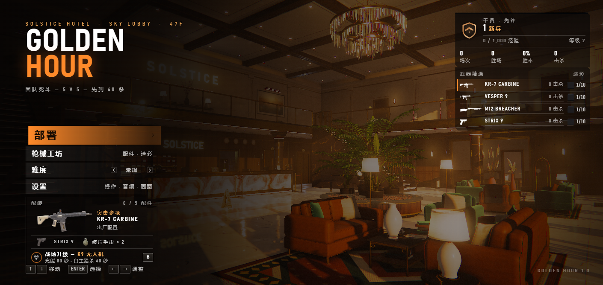
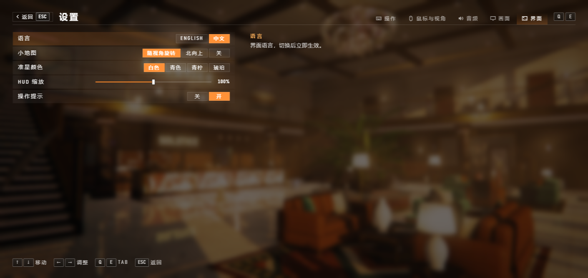
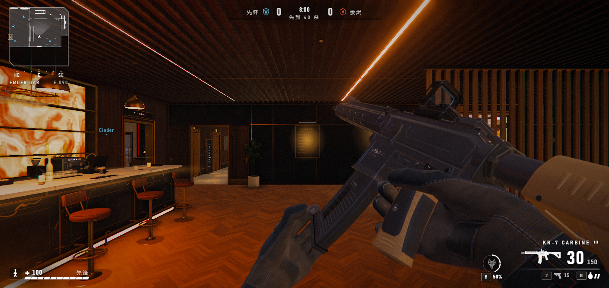

# GOLDEN HOUR — Solstice Hotel

# 原作者分享地址；https://x.com/JaydenDavisNC/status/2120553601269473432

一个纯 HTML / WebGL 的网页 FPS：**5v5 团队死斗**，单张地图「Solstice Hotel · 天空大堂 47F」，先到 **40 击杀**获胜。带武器改装（Gunsmith）、迷彩、武器精通、难度、设置、K9 无人机战场升级、AI 队友与敌人。

**现在可以离线本地运行**：双击 `启动游戏.bat`（或直接双击 `index.html`），点 **DEPLOY** 开局。





---

## 1. 文件

| 文件 / 目录 | 是什么 | 是否必需 |
|---|---|---|
| `index.html` | **入口页（我补回来的）**：完整 DOM 结构 + 全部 HUD/菜单样式 + 加载 `dist/game.js` | ✅ 必需 |
| `dist/game.js` | **游戏本体**（2.8 MB）：打包了 three.js 与全部游戏逻辑，贴图/模型/音效全是程序化生成，不依赖任何外部素材 | ✅ 必需 |
| `main.js` | **Cloudflare 人机验证脚本**（`window._cf_chl_opt`，高度混淆），不是游戏代码 | ⛔ 无关 |
| `assets/*.js`、`assets/*.woff2` | Claude 网页版「artifact 预览器」的前端代码与字体（`frame-shell`、`shared-frame` 等） | ⛔ 无关 |
| `_runtime/*.js` | Claude 预览器的 frame runtime（`_transforms`、`_translate`） | ⛔ 无关 |
| `网页游戏样本.url` | 指向 `claude.ai/artifact/6N9gzgYJDa925a1tVxps2f` 的快捷方式 | 参考 |
| `i18n.js` | **中英双语引擎**：语言状态、词表、文本翻译、设置行注入 | ✅ 必需（删掉则只有英文） |
| `_orig/index.artifact.html` | 从原始托管地址取回的页面原件（未删减），留作备份 | 参考 |
| `_orig/game-patches.md` | 我对 `dist/game.js` 做的 3 处最小改动说明（可还原） | 参考 |
| `screenshots/` | 本地运行验证截图 | 参考 |

## 2. 为什么下载下来的文件打不开

`dist/game.js` **不是一个独立页面**，它只负责逻辑：它假设 HTML 里已经存在 `#hud`、`#weapon`、`#ui`、`#mm` 等一百多个节点，样式表也在那个 HTML 里。

只有 `game.js` 时一启动就报：

```
TypeError: Cannot read properties of null (reading 'querySelector')
```

（缺的是 `#weapon` 里的 `.wmain`。）

## 3. 入口页是怎么补回来的

`网页游戏样本.url` → `https://claude.ai/artifact/6N9gzgYJDa925a1tVxps2f`。
`dist/` 下的缓存目录名正好暴露了托管路径，于是原始静态地址是：

```
https://2b71aae7-f567-45cd-9392-4374412a0670.frame.claudeusercontent.com/_f/1794413451-9695/index.html
```

该地址目前仍可公开访问（Cloudflare 缓存），下载后得到 127 KB 的原始页面（标题 `GOLDEN HOUR — Solstice Hotel`，尾部脚本动态加载 `dist/game.js`）。我做的处理只有一件：**删掉页面顶部 Claude 预览器的 `frame-runtime` 前置脚本**（37 KB，只负责和 claude.ai 父页面通信），其余原样保留，并写成 `index.html`。原件在 `_orig/index.artifact.html`。

## 4. 运行方法

**方式 A（推荐）**：双击 `启动游戏.bat` → 自动用 Chrome / Edge 打开 `index.html`。
也可以直接双击 `index.html`，或把整个文件夹拖到浏览器窗口。

**方式 B（本地服务器）**：如果浏览器对 `file://` 有限制：

```bat
py -m http.server 8123
```

然后打开 <http://127.0.0.1:8123/>。

要点：

- 用 **Chrome / Edge**（需要 WebGL2；本机 Edge 157 已验证）。
- 进对局时浏览器会锁定鼠标；**Esc** 释放鼠标并暂停。
- 无网络也能玩：`game.js` 不请求任何外部资源。
- 移动端不建议（无触屏操作层）。

### URL 参数

| 参数 | 作用 |
|---|---|
| `?autostart` | 跳过菜单直接开局 |
| `?nolock` | 不锁定鼠标（调试 / 自动化截图用） |
| `?b=xxx` | 改加载 `dist/game-xxx.js` 变体（当前只有默认版） |

## 5. 语言（中文 / English）

- **入口**：`设置 → 界面（INTERFACE）→ 语言`，可选 **ENGLISH / 中文**，点一下立即生效，无需重启。
- **默认值**：首次启动跟随系统语言（中文系统默认中文）；之后记住你的选择，存在 `localStorage["golden-hour-lang"]`。
- **翻译范围**：主菜单、设置页（含每项说明）、枪械工坊（配件 / 迷彩 / 描述）、对局 HUD、计分板、暂停、结算、勋章与击杀播报、加载阶段文字、战地笔记。
- **保留英文**：武器与配件型号（如 `KR-7 CARBINE`、`VANTAGE 2.5×`）、地图与场所名（`SOLSTICE HOTEL`、`EMBER BAR`）、按键名（`ENTER` / `TAB` / `ESC`）、`K9` 等缩写，以及贴在场景里的海报 / 标识（属于贴图，不是界面）。
- **实现方式**：`i18n.js` 用 MutationObserver 监听文本节点做双向替换（英文原文存在 WeakMap 里，切回英文可无损还原），并在游戏的设置 schema 中插入一行真实的“语言”设置项——所以键盘 ↑↓←→、焦点、胶囊滑块动画都和原生设置项一致。
- **想改词 / 加语言**：编辑 `i18n.js` 顶部的 `DICT`（英文 → 目标语言）；带数字的文案（如 `0 / 5 ATTACHMENTS`）在 `RULES` 里用正则处理。

## 6. 键位

| 操作 | 键 |
|---|---|
| 移动 / 跳跃 | `WASD` / `Space` |
| 冲刺 | `Shift` |
| 蹲下 | `C` |
| 滑铲 | `X` 或 `Z` |
| 开火 / 瞄准 | 鼠标左键 / 右键 |
| 换弹 | `R` |
| 近战 | `V` / `F` / 鼠标侧键 |
| 手雷 | `G` / `Q` |
| 换枪 | `1` `2` `E` |
| 检视武器 | `T` |
| 计分板 | `Tab`（按住） |
| K9 无人机 | `B` 或 `3` |
| 菜单 / 暂停 | `Esc` |

## 7. 验证记录（本机无头 Edge + SwiftShader，CDP 实时截图）

- 主菜单中文渲染正常：`screenshots/menu.png`
- 设置 → 界面：新增“语言”行，选中“中文”，说明文字同步中文：`screenshots/zh-settings.png`
- 点击 ENGLISH → 界面立刻全英文；点 中文 → 立刻全中文；刷新后仍保持所选语言（`localStorage` 已写入）
- 对局内 HUD 中文：`1610` draw calls、`8.75M` 三角形、`60` fps（与英文时基本一致）：`screenshots/zh-ingame.png`
- 键盘导航：在“语言”行按 `←` 切到 ENGLISH、`→` 切回，菜单文案随之切换

## 8. 设置与调试接口

- 画质、灵敏度等设置写入 `localStorage["golden-hour-settings-v1"]`。
- 控制台里有调试对象 `window.GH`：

```js
GH.debug.navCheck()          // { links, islands, bad, calls, tris, fps }
GH.debug.tp(x, y, z, yaw, pitch)   // 传送
GH.debug.look(yaw, pitch)    // 设定视角（度）
GH.debug.key("KeyW", true)   // 模拟按键
GH.debug.hud(false)          // 隐藏 / 显示 HUD
GH.debug.arsenal             // 武器与配件数据
GH.debug.world               // 场景与导航图
GH.debug.bots                // AI 状态
GH_I18N.getLang()            // 当前界面语言："zh" / "en"
GH_I18N.setLang("zh")        // 代码里切换语言（与设置项等价）
GH_I18N.dict                 // 中英词表
```

## 9. 备注

- `dist/game.js` 是压缩过的打包产物（6285 行）。为了让“语言”成为一条**原生设置项**，我做了 3 处最小改动（详见 `_orig/game-patches.md`，可还原）：在 `INTERFACE` 配置里加了一行语言设置、暴露 `window.__GH_SETTINGS` / `window.GH.debug.schema` 给 `i18n.js` 读取。游戏逻辑、画面、玩法未做改动。
- 新增文件：`index.html`（补回的入口页）、`i18n.js`（双语引擎）、`启动游戏.bat`、`说明.md`、`_orig/`、`screenshots/`。
- 版权归原作者（原页面页脚标注 `GOLDEN HOUR 1.0`）；这里只是把缺失的入口页补上、并加了一层中英双语界面，方便本地离线游玩。
